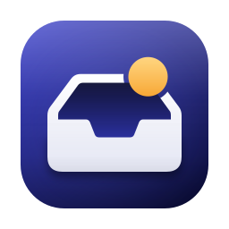

<div align="center">



# Tidy

**A tidy inbox for your GitHub notifications, in the macOS menu bar.**

[Download](https://github.com/gustaferiksson/tidy/releases/latest) · [Install with Homebrew](#install) · Requires macOS 26

</div>

## What it does

Tidy treats GitHub notifications like email. Opening a thread reads it, Done archives it, and everything stays in sync with your inbox on github.com.

| | |
|---|---|
| **One inbox** | Pull requests, issues, discussions, releases, CI runs and security alerts (Dependabot, secret scanning, advisories) in a single list, newest first. |
| **State at a glance** | GitHub's own Octicons in GitHub's colours: open, draft, merged, closed, not planned, failed. Shape and text back up colour for accessibility. |
| **Quick Look** | Branch and diff size, reviewers and their verdicts, checks, labels, assignees, the description and the latest conversation, without opening a browser. |
| **Read and Done** | Opening a thread marks it read, Space peeks without reading. Done archives it on GitHub, with a few seconds to undo. |
| **Filters and mute** | Mail-style rules by repo, org, reason, type, author or state. Mute a thread or a whole repository. |
| **Notifications** | Native banners with Quick Look, Mark as Read and Done buttons, grouped by repository, with a choice of which reasons notify. |
| **Menu bar** | Icon and count, count only, or icon only. The count can track unread threads or everything not done. |

### Keyboard

| Key | Action |
|---|---|
| <kbd>↑</kbd> <kbd>↓</kbd> | Move the selection, or step between threads in Quick Look |
| <kbd>↩</kbd> | Open Quick Look and mark read |
| <kbd>Space</kbd> | Peek without marking read |
| <kbd>⌘</kbd><kbd>↩</kbd> | Open on GitHub and mark read (<kbd>⌥</kbd><kbd>⌘</kbd><kbd>↩</kbd> leaves it unread) |
| <kbd>E</kbd> | Done |
| <kbd>⇧</kbd><kbd>I</kbd> / <kbd>⇧</kbd><kbd>⌘</kbd><kbd>I</kbd> | Mark as Read / Mark All as Read |
| <kbd>⇧</kbd><kbd>M</kbd> | Mute Thread |
| <kbd>⌘</kbd><kbd>Z</kbd> | Undo |
| <kbd>⌘</kbd><kbd>1</kbd> / <kbd>⌘</kbd><kbd>2</kbd> | Unread / All |
| <kbd>⌘</kbd><kbd>R</kbd> | Refresh |
| <kbd>Esc</kbd> | Close Quick Look, then the panel |

Done, Mark as Read and Mute Thread follow GitHub's notifications inbox and can be changed in Settings › Keyboard.

## Install

```sh
brew install --cask gustaferiksson/tap/tidy
```

Or download `Tidy-<version>.zip` from the [latest release](https://github.com/gustaferiksson/tidy/releases/latest) and move `Tidy.app` to `/Applications`. Tidy is signed and notarized, and updates itself.

## Set up

1. [Create a classic personal access token](https://github.com/settings/tokens/new?scopes=notifications,repo&description=Tidy). The link prefills the `notifications` and `repo` scopes.
2. Paste it in Settings › GitHub and press Connect.

Fine-grained tokens won't work: GitHub's notifications API doesn't accept them. The token is stored only in your Keychain, on this Mac.

<details>
<summary><b>Privacy</b></summary>

<br>

Tidy talks to `api.github.com` and nothing else. There is no server, no account and no telemetry. Responses are cached in Application Support, and links in comments only open when they point at GitHub.

</details>

<details>
<summary><b>How it works</b></summary>

<br>

Tidy polls `GET /notifications` with conditional requests, so an unchanged inbox returns `304 Not Modified` and costs no rate limit. It waits at least as long as GitHub's `X-Poll-Interval` asks (60 seconds or more), and pauses while the Mac sleeps or is offline. Subject details are fetched only for new or changed threads, and Quick Look's reviews and checks come from one GraphQL request when you open a thread.

Why not push? GitHub offers no push channel for notifications to a personal token. Webhooks need a server and repo admin rights, so polling is the only option that keeps Tidy serverless.

</details>

<details>
<summary><b>Building from source</b></summary>

<br>

You need Xcode, [XcodeGen](https://github.com/yonaskolb/XcodeGen) and `rsvg-convert` (`brew install xcodegen librsvg`).

```sh
./build.sh                                     # dist/Tidy.app, ad hoc signed unless .env sets a team
swift test --package-path Packages/TidyCore    # logic tests
```

The Xcode project is generated by XcodeGen and isn't tracked. Releases are tagged and built by GitHub Actions, see [docs/RELEASING.md](docs/RELEASING.md) and [SHIPPING.md](SHIPPING.md).

</details>

## License

[MIT](LICENSE). State glyphs are GitHub's [Octicons](https://github.com/primer/octicons), also MIT ([notice](LICENSES/octicons.txt)).
